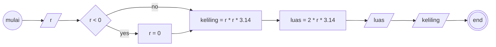

### Penjelasan kode JS
saya membuat variabel lingkaran yang miliki properti radius, keliling, dan luas, kemudian ada 3 method yakni cekApakahLebihKecilDariNol, HitungKelilingDanLuas, dan CetakHasil
kemudian untuk mengubah nilai radius cukup reassign nilai property radius, kemudian panggil method CetakHasil kembali, ketika method CetakHasil atau HitungKelilingDanLuas dipanggil
maka nilai properti keliling dan luas juga akan diupdate

