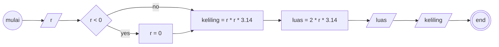

### Penjelasan kode JS
saya membuat variabel obj yang berisi properti radius, keliling, dan luas. kemudian saya membuat 3 fungsi yakni cekApakahLebihKecilDariNol, hitungLuasDanKeliling, dan tampilkanKelilingDanLuasLingkaran.
untuk function cekApakahLebihKecilDariNol hanya menerima parameter l yang harus diisi dengan objek obj, kemudian untuk function hitungLuasDanKeliling memiliki dua parameter yang pertama objek obj
dan yang kedua adalah callback untuk function cekApakahLebihKecilDariNol, terakhir function tampilkanKelilingDanLuasLingkaran memiliki parameter pertama untuk menerima objek obj dan menerima callback hitungLuasDanKeliling

