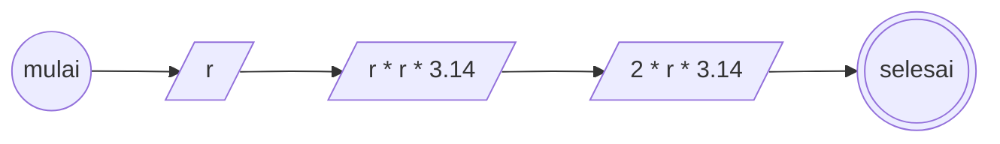

## menghitung luas dan keliling lingkaran
1. mulai
2. tentukan nilai jari - jari lingkaran (r)
3. untuk menghitung luas lingkaran, maka nilai jari - jari yang dikuadratkan (r * r) di kalikan nilai pi (pi * r * r), dimana nilai pi bisa di approksimasikan sebagai 3.14
4. untuk menghitung keliling, maka nilai jari - jari dikali dengan 2 kali pi (2 * pi * r)
5. selesai

### flowchart


### Pseudo Code

```
DECLARE r : REAL
INPUT r
OUTPUT r * r * 3.14
OUTPUT 2 * r * 3.14
```
